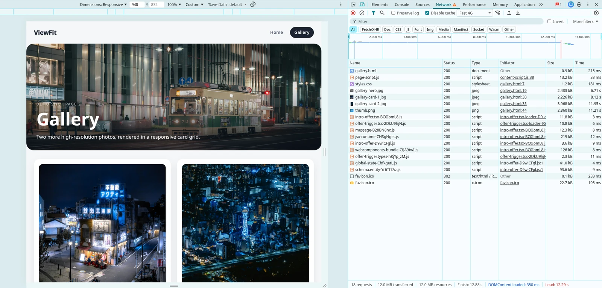

# ViewFit

Fit and compress every image to the size it is actually rendered at, using a real headless browser.

ViewFit opens your site in Chromium, measures each `` and CSS `background-image` with `getBoundingClientRect()`, applies the device pixel ratio, and recommends a per-image target size. Sharp then resizes and compresses each file individually instead of applying one generic setting to everything.

## Requirements

- Node.js >= 18
- A Chromium browser for Playwright:
  - `npx playwright install chromium`, or
  - use an installed Google Chrome with `--browser chrome`

## Install

```bash
npm install -g viewfit        # then run: viewfit
# or run without installing:
npx viewfit
```

## Quick start

```bash
# Report only. Nothing is written to disk.
viewfit ./dist

# Write an optimized copy of the site with one preset.
viewfit optimize ./dist --preset web --site --yes
```

`./dist` is the folder to analyze: whatever your build outputs (`dist`, `build`, `out`, `public`, or `.` for the current directory). When it is a folder, ViewFit recursively analyzes every `.html`/`.htm` page inside it (skipping `node_modules`, `.git` and the output folder). You can also pass a single HTML file or an already running URL.

## Before / after

The Chrome DevTools Network panel for the demo gallery page, before and after ViewFit. Click an image to open it full size.

| Before | After |
| --- | --- |
| [](https://raw.githubusercontent.com/andrea-bonacci/viewfit/main/docs/before.webp) | [](https://raw.githubusercontent.com/andrea-bonacci/viewfit/main/docs/after.webp) |
| **12.0 MB · 12.88 s** | **893 KB · 1.21 s** |

Same page and same 18 requests. Its four images go from 2.4 MB, 2.2 MB, 4.0 MB and 2.9 MB to 55 KB, 101 KB, 176 KB and 19 KB as WebP.

### Single image

The card is rendered at 733×949. Both images are shown at the same display width; click one to open it full size.

| Before (JPG) | After (WebP) |
| --- | --- |
| <a href="https://raw.githubusercontent.com/andrea-bonacci/viewfit/main/examples/demo-site/assets/gallery-card-1.jpg"></a> | <a href="https://raw.githubusercontent.com/andrea-bonacci/viewfit/main/docs/gallery-card-1-after.webp"></a> |
| **2.2 MB** · 3902×5050 | **101 KB** · 733×949 |

## Two commands

| Command | What it does |
| --- | --- |
| `viewfit [target]` | Analyze and print a report. Never writes files. |
| `viewfit inspect [target]` | Explicit name for the same report-only command. |
| `viewfit optimize [target]` | Analyze, then write the optimized images. Asks for confirmation. |

A directory target means **all HTML pages recursively**; each unique image is reported and compressed once, using the largest rendered size found across pages.

## Presets

`--preset` sets device, tier, format and quality with one flag. Any option passed explicitly overrides the preset.

| Preset | Device | Format | Tier | Quality |
| --- | --- | --- | --- | --- |
| `web` | Mobile | WebP | 90% | 80 |
| `hq` | Desktop | AVIF | 100% | 85 |
| `fast` | Mobile | WebP | 75% | 70 |

## Common examples

```bash
# Analyze a build output on desktop
viewfit ./dist

# Analyze as mobile
viewfit ./dist --device mobile

# Custom tier: 80% of the exact rendered size
viewfit ./dist --tier 80

# Write to a custom folder, converting to WebP
viewfit optimize ./dist --format webp --out optimized

# Also copy HTML/CSS/JS and rewrite image references
viewfit optimize ./dist --preset web --site --yes

# Overwrite originals (same format only)
viewfit optimize ./dist --in-place --yes

# Interactive choices for tier, format and quality
viewfit optimize ./dist --interactive
```

## Options

| Option | Description | Default |
| --- | --- | --- |
| `[target]` | Local directory, HTML file or URL | `.` |
| `-p, --preset <name>` | `web`, `hq` or `fast` | none |
| `-d, --device <mode>` | `desktop` or `mobile` | preset or `desktop` |
| `--viewport <w>x<h>` | Viewport override, e.g. `1440x900` | device preset |
| `-t, --tier <tier>` | `exact`, `safe`, `aggressive`, `extreme` or a number (1-100) | preset or `exact` |
| `-q, --quality <number>` | Encoder quality (1-100) | preset or `80` |
| `-f, --format <format>` | `original`, `webp` or `avif` | preset or `original` |
| `--out <dir>` | Output directory (only `optimize`) | `viewfit-output` |
| `-w, --in-place` | Overwrite originals (requires `--format original`) | `false` |
| `--site` | Copy HTML/CSS/JS into the output folder and rewrite image references | `false` |
| `--root <dir>` | Root used to map URLs to local files when using a URL | none |
| `--browser <channel>` | Playwright channel: `chromium` or `chrome` | `chromium` |
| `--timeout <ms>` | Navigation timeout | `30000` |
| `-i, --interactive` | Choose tier, format and quality interactively | `false` |
| `-y, --yes` | Skip confirmation prompts | `false` |
| `--json` | Print the analysis as JSON | `false` |

### Tiers

| Tier | Scale |
| --- | --- |
| `exact` | 100% of the exact rendered size |
| `safe` | 90% |
| `aggressive` | 75% |
| `extreme` | 50% |
| number | Custom percentage, e.g. `--tier 85` |

## Demo

A ready-to-run example lives in [`examples/demo-site`](https://github.com/andrea-bonacci/viewfit/tree/main/examples/demo-site). It has two pages, six high-resolution Unsplash photos and a heavy PNG icon (about 24 MB total). The before/after screenshots above come from this example. From the repository root:

```bash
npm run build
node dist/cli.js ./examples/demo-site --browser chrome
node dist/cli.js ./examples/demo-site --browser chrome --device mobile --tier 80
```

## How it works

1. Discovers every HTML page in the target directory (or uses the single file/URL).
2. Serves the target directory and opens each page in Chromium with the selected viewport, device pixel ratio and mobile emulation.
3. Scrolls each page to trigger lazy loading and waits for images to decode.
4. Collects every rendered `` and CSS background image with its CSS box and fit mode, merging duplicates across pages.
5. Reads real dimensions and file size with Sharp.
6. Computes the target size from the rendered box, DPR and compression tier.
7. Prints a report with original size, rendered size, target size and estimated savings.
8. With `optimize`, resizes and re-encodes each image with Sharp.
9. With `--site`, copies HTML/CSS/JS into the output folder and rewrites image references to the new files.

Images that cannot be mapped to a local file (remote/CDN assets) are reported but not modified.

## Development

```bash
npm install
npm run dev -- ./dist --browser chrome
npm run typecheck
npm test
npm run build
```

## License

MIT
